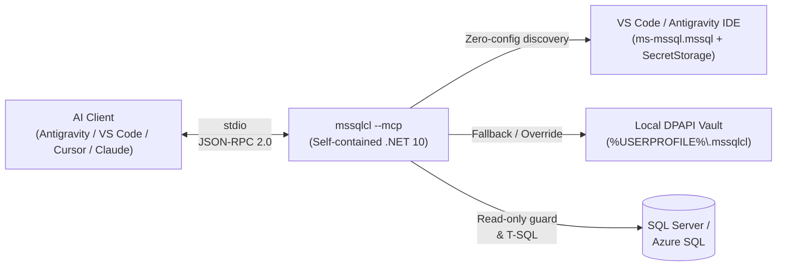
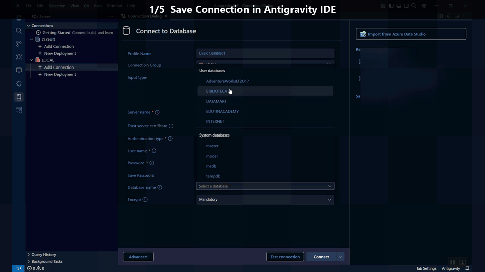

<div align="center">

  

  <h1>mssqlcl</h1>

  <p>
    <strong>SQL Server MCP Server &amp; CLI with zero-config connection discovery for VS Code and Antigravity IDE.</strong>
  </p>

  <p>
    <a href="https://github.com/codevswia/mssqlcl/releases"></a>
    
    
    <a href="https://modelcontextprotocol.io"></a>
    <a href="LICENSE"></a>
  </p>

  <p>
    <a href="#-features">Features</a> •
    <a href="#-prerequisites">Prerequisites</a> •
    <a href="#-installation">Installation</a> •
    <a href="#-mcp-client-configuration">MCP Setup</a> •
    <a href="#-mcp-tools-reference">Tools (11)</a> •
    <a href="#-cli-usage">CLI</a> •
    <a href="#-security">Security</a>
  </p>

</div>

---

Configure your SQL Server connections **once** in **VS Code**, **Antigravity IDE** (`ms-mssql.mssql`), or via `mssqlcl conn save`, and expose them safely to any MCP-compatible AI client (**Antigravity**, **Claude Desktop**, **Claude Code**, **Cursor**, etc.) over `stdio`.



### 🎥 Quick Demo — End-to-End in Antigravity

<div align="center">
  
</div>

---

## ✨ Features

| Capability | What it gives you |
| :--- | :--- |
| **Zero-Config IDE Discovery** | Automatically reads `mssql.connections` and `mssql.connectionGroups` (JSONC) from **Antigravity IDE**, **VS Code**, and `%USERPROFILE%\.mssqlcl\connections.json`. |
| **Automatic Credential Resolution** | Supports **Windows Auth (`Integrated`)**, **SQL Login (`SqlLogin`)** via Electron `SecretStorage` (`Local State` DPAPI + `state.vscdb` AES-256-GCM) or local DPAPI vault, and **Microsoft Entra ID / MFA (`AzureMFA`)**. |
| **20 Multi-Connection MCP Tools** | Full server discovery, connection management, schema/object inspection, Query Store diagnostics, and query execution keyed by `connectionId`. |
| **Token-Efficient Output** | Compact **CSV** output by default (optional `json`) with `--max-rows` capping (default `500`) to minimize LLM token usage. |
| **Read-Only Lexical Guard** | `--readonly` enabled by default: skips comments, string literals, and quoted identifiers while blocking DML/DDL/execution keywords (`INSERT`, `UPDATE`, `DELETE`, `MERGE`, `DROP`, `ALTER`, `CREATE`, `TRUNCATE`, `EXEC`, `SELECT ... INTO`, etc.). |
| **Clean `stdio` & Local Audit** | Diagnostics go exclusively to `stderr`. Queries are logged locally to JSONL at `%USERPROFILE%\.mssqlcl\audit.log` without touching target databases or logging secrets. |

---

## 📋 Prerequisites

- **Operating System:** Windows 10 / 11 (`x64`) — required for Windows DPAPI and Electron `SecretStorage` decryption.
- **Connection Source *(choose one)*:**
  - **Recommended (Zero-Config):** **VS Code** or **Antigravity IDE** with the **[SQL Server (`ms-mssql.mssql`)](https://marketplace.visualstudio.com/items?itemName=ms-mssql.mssql)** extension and your connections already saved.
  - **Standalone (No IDE required):** Manage profiles directly via `mssqlcl conn save` (stored in `%USERPROFILE%\.mssqlcl\` encrypted with Windows DPAPI) or `MSSQLCL_PWD_<PROFILE>` environment variables.
- **Runtime:**
  - **End users (Release ZIP / Installer):** **No .NET installation required** (self-contained binary).
  - **Building from source:** [.NET 10 SDK](https://dotnet.microsoft.com/download).

> [!TIP]
> If you already use the `ms-mssql.mssql` extension in VS Code or Antigravity IDE, you don't need to re-enter passwords or maintain separate connection strings—`mssqlcl` discovers them automatically.

---

## 📦 Installation

### Option 1: One-Command Online Installer *(PowerShell, no .NET SDK required)*

```powershell
irm https://raw.githubusercontent.com/codevswia/mssqlcl/main/scripts/install.ps1 | iex
```

Downloads the latest release ZIP to `%LOCALAPPDATA%\Programs\mssqlcl` and adds it to your User `PATH` (no Administrator privileges required).

<details>
<summary><strong>Option 2: Portable ZIP (Offline — Zero system changes or User PATH)</strong></summary>

1. Download `mssqlcl-vX.Y.Z-win-x64.zip` from [GitHub Releases](https://github.com/codevswia/mssqlcl/releases).
2. Extract it anywhere (for example `C:\tools\mssqlcl\`).
3. Choose how you want to run it:
   - **Portable (zero system changes):** Point your MCP config directly to `C:\tools\mssqlcl\mssqlcl.exe` (no `PATH` changes).
   - **Install to User `PATH` (no Admin required):** Double-click `install.cmd` (or run `powershell -ExecutionPolicy Bypass -File .\install-local.ps1`) to copy `mssqlcl.exe` to `%LOCALAPPDATA%\Programs\mssqlcl` and add it to your User `PATH`. Restart your IDE afterwards if it was already open.
   - **Offline via main installer:** `.\scripts\install.ps1 -LocalZip path\to\mssqlcl-vX.Y.Z-win-x64.zip`

</details>

<details>
<summary><strong>Option 3: Build &amp; Install from Source (requires .NET 10 SDK)</strong></summary>

```powershell
# Build & run unit tests
dotnet test

# Build and install mssqlcl.exe to %LOCALAPPDATA%\Programs\mssqlcl and add to User PATH
.\scripts\install.ps1 -FromSource

# Or build a standalone self-contained binary from source
.\scripts\install.ps1 -FromSource -SelfContained
```

</details>

---

## 🔌 MCP Client Configuration

Add `mssqlcl` to your MCP client configuration (such as **Antigravity IDE** `mcp_config.json`, **Claude Desktop** `claude_desktop_config.json`, or **Cursor**):

```json
{
  "mcpServers": {
    "mssqlcl": {
      "command": "mssqlcl",
      "args": ["--mcp"]
    }
  }
}
```

> [!NOTE]
> If you installed `mssqlcl` in portable mode without adding it to `PATH`, replace `"mssqlcl"` in `"command"` with the full path (e.g. `"C:\\tools\\mssqlcl\\mssqlcl.exe"`).

### Optional MCP Flags

| Flag | Default | Description |
| :--- | :--- | :--- |
| `--readonly` | enabled | Blocks DML/DDL/EXEC statements via lexical T-SQL inspection |
| `--readwrite` | off | Allows write/DDL statements in `mssql_run_query` |
| `--max-rows <N>` | `500` | Caps returned rows per result set |
| `--timeout <sec>` | `30` | Default SQL command timeout in seconds |
| `--source <mode>` | `auto` | `auto`, `antigravity`, `vscode`, or `local` |
| `--no-audit` | off | Disables writing to `%USERPROFILE%\.mssqlcl\audit.log` |

---

## 🎬 Video Walkthroughs

<details open>
<summary><strong>🚀 Antigravity (IDE + App) — Full Walkthroughs</strong></summary>

<blockquote>

<details>
<summary>▶️ <strong>Guide 1: SQL Login</strong> — Save connection, install <code>mssqlcl</code> MCP &amp; query SQL Server (3m 41s)</summary>

https://github.com/user-attachments/assets/b5a99cef-7ed1-4fe2-acab-0bd34b7e16ae

</details>

<details>
<summary>▶️ <strong>Guide 2: Microsoft Entra ID / MFA</strong> — Save Azure SQL MFA connection, install MCP &amp; query with AI (3m 38s)</summary>

https://github.com/user-attachments/assets/1ff4a37a-32d5-432e-9a07-061de0f1503d

</details>

</blockquote>

</details>

<details>
<summary><strong>💻 VS Code — Full Walkthroughs (Coming Soon)</strong></summary>

<blockquote>

*Walkthroughs for VS Code (`ms-mssql.mssql`) coming soon.*

</blockquote>

</details>

---

## 🛠️ MCP Tools Reference

`mssqlcl` exposes **20 database tools** to your AI assistant, supporting multiple simultaneous connections via `connectionId`:

| Category | Tool | Description |
| :--- | :--- | :--- |
| **Discovery** | `mssql_list_servers` | Lists discovered SQL Server profiles from Antigravity IDE, VS Code, and local vault |
| **Connection** | `mssql_connect` | Opens a connection to a profile and returns a `connectionId` |
| **Connection** | `mssql_disconnect` | Closes an active `connectionId` session |
| **Connection** | `mssql_get_connection_details` | Returns active connection metadata (server, database, auth type, state) |
| **Connection** | `mssql_change_database` | Switches the active database context (`USE <db>`) for a `connectionId` |
| **Schema** | `mssql_list_databases` | Lists databases on the connected SQL Server instance |
| **Schema** | `mssql_list_schemas` | Lists schemas in the current database |
| **Schema** | `mssql_list_tables` | Lists tables (with schema and metadata) |
| **Schema** | `mssql_list_views` | Lists views in the current database |
| **Schema** | `mssql_list_functions` | Lists scalar/table-valued functions |
| **Query** | `mssql_run_query` | Executes T-SQL (protected by `--readonly` guard by default, CSV/JSON output) |
| **Query Store** | `mssql_query_store_status` | Checks Query Store state, storage usage, retention, and capture mode |
| **Query Store** | `mssql_query_store_top_queries` | Top N queries ranked by duration, CPU, logical reads, writes, memory, or executions |
| **Query Store** | `mssql_query_store_query_details` | SQL text, compile metadata, and aggregated runtime metrics for a `queryId` |
| **Query Store** | `mssql_query_store_history` | Time-bucketed execution history for a `queryId` |
| **Query Store** | `mssql_query_store_wait_stats` | Top Query Store wait categories (SQL Server 2017+ / Azure SQL) |
| **Query Store** | `mssql_query_store_plans` | Execution plans, metrics, forced status, and force failures for a `queryId` |
| **Query Store** | `mssql_query_store_analyze_query` | Consolidated diagnostic (details + plans + waits + multi-plan/failure flags) |
| **Query Store** | `mssql_query_store_verify_forced_plan` | Verifies whether a forced plan is active and free of force failures |
| **Query Store** | `mssql_query_store_force_plan` | Forces or unforces a plan (`--readwrite` required) |

---

## 💻 CLI Usage

Use the CLI directly to verify your environment, inspect discovered IDE profiles, or manage local DPAPI credentials:

```powershell
# Verify environment, IDE discovery paths, and local vault health
mssqlcl doctor

# List discovered profiles and credential resolution status
mssqlcl conn list

# Test live connectivity for a profile (prefix with antigravity: or vscode: if duplicated)
mssqlcl conn test "MyServer\MyDatabase"
mssqlcl conn test "vscode:MyServer\MyDatabase"

# Create a local profile or store a DPAPI-protected password override
mssqlcl conn save --profile "LocalDev" --server "localhost\SQLEXPRESS" --database "AppDb" --user "sa" --savepwd
mssqlcl conn save --profile "ExistingIdeProfile" --savepwd

# Delete a local profile
mssqlcl conn delete "LocalDev"
```

---

## 🔒 Security

> [!IMPORTANT]
> Only pass `--readwrite` against databases where write or DDL operations are explicitly intended.

- **Zero plaintext secret leaks:** `mssqlcl` never writes decrypted passwords to disk, `stdout`, `stderr`, or `audit.log`.
- **Safe IDE vault reading:** `state.vscdb` is copied to a temporary file in read-only mode before querying and deleted immediately afterwards, so it works safely even while **VS Code** or **Antigravity IDE** is running.
- **Zero target database footprint:** Audit logs are stored strictly locally at `%USERPROFILE%\.mssqlcl\audit.log`.

---

## 👤 Author & Organization

- **Author:** Brayan Raul Sullca Ccarampa
- **Organization:** [codevswia](https://github.com/codevswia) — *Human Ideas. AI-Powered Development.*
- **Repository:** [github.com/codevswia/mssqlcl](https://github.com/codevswia/mssqlcl)

## 📄 License

Distributed under the **MIT License** — see [LICENSE](LICENSE) for details.

<!-- mcp-name: io.github.codevswia/mssqlcl -->
